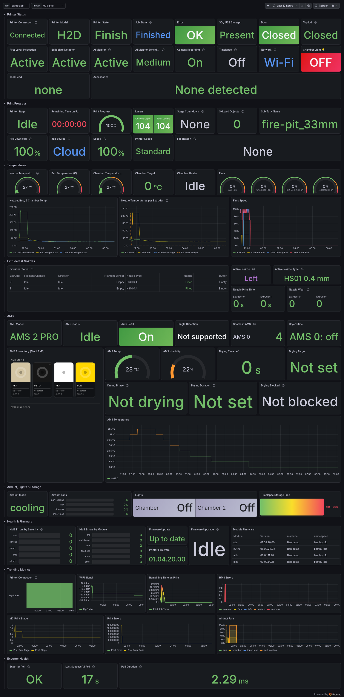

<p align="center">
  <picture>
    <source media="(prefers-color-scheme: dark)" srcset="docs/brand/svg/icon.svg">
    
  </picture>
</p>

<p align="center"><em>Not affiliated with Bambu Lab.</em></p>

# bambulab_metrics_exporter

[](https://www.python.org/downloads/release/python-3110/)
[](https://github.com/TheBlackBush/bambulab_metrics_exporter/releases)
[](https://github.com/TheBlackBush/bambulab_metrics_exporter/actions/workflows/docker-publish.yml)
[](https://github.com/TheBlackBush/bambulab_metrics_exporter/pkgs/container/bambulab_metrics_exporter)
[](https://github.com/TheBlackBush/bambulab_metrics_exporter/pkgs/container/bambulab_metrics_exporter)
[](https://hub.docker.com/r/blackbush/bambulab_metrics_exporter)
[](https://grafana.com/grafana/dashboards/25033-bambulab-metrics)
[](https://ko-fi.com/M4M11W3R7J)

> A Prometheus exporter for **Bambu Lab** 3D printers.
> It runs as a small Docker container, reads your printer's live status on your home network or
> through Bambu Cloud, and publishes it for [Prometheus](https://prometheus.io/) to collect and
> [Grafana](https://grafana.com/) to chart: prints, temperatures, fans, AMS filament, errors and
> firmware, with history and alerts. It only reads; it never controls the printer.



<sub>The ready-made Grafana dashboard (grafana.com ID 25033) with an H2D. Your dashboard shows your
own printers.</sub>

Full documentation is in the **[wiki](https://github.com/TheBlackBush/bambulab_metrics_exporter/wiki)**.

## Contents

- [Supported printers](#supported-printers)
- [How it works](#how-it-works)
- [Features](#features)
- [Quick start](#quick-start)
- [Grafana dashboard](#grafana-dashboard)
- [Documentation](#documentation)
- [Help and feedback](#help-and-feedback)
- [Development](#development)
- [License](#license)

---

## Supported printers

| Series | Models | Tested on real hardware |
|---|---|---|
| A | A1, A1 mini, A2L | |
| P | P1P, P1S, P2S | |
| X | X1, X1 Carbon, X1E, X2D | X1 Carbon |
| H | H2C, H2D, H2D Pro, H2S, H3C | H2D (idle and printing) |

AMS units: **AMS**, **AMS Lite**, **AMS 2 Pro**, **AMS HT** and **AMS 3H**, plus the external spool.

Every model in the table is recognized, and the exporter leaves out metrics for hardware a model
does not have (for example the chamber heater on a P1S). Models not yet tested on real hardware
are recognized from their data and may report some values differently. The
[Metrics Reference](https://github.com/TheBlackBush/bambulab_metrics_exporter/wiki/Metrics-Reference#supported-models)
lists what each model has.

**Own a model that is not tested yet, or one marked "Unsupported printer"?** Open the exporter's
**Diagnostics** page and click **Create GitHub issue**. It sends a report with serial numbers,
addresses, names and credentials removed, so the model can be checked or added.

---

## How it works

```text
Printer (LAN or Bambu Cloud)  ->  exporter :9109/metrics  ->  Prometheus  ->  Grafana
```

Bambu Lab printers publish their state over MQTT. The exporter listens to that feed, asks for a
full update every 10 seconds, and turns it into Prometheus metrics.

| Connection | What you provide | Good to know |
|---|---|---|
| **Local (LAN)** | Printer IP address, serial number and LAN access code (on the printer: Settings, Network) | Talks to the printer directly; no Bambu Cloud account needed |
| **Bambu Cloud** | Your Bambu Lab account email and the code it emails you, then tick the printers to monitor | No IP or access code needed; the login renews itself and is stored encrypted |

You set up both in your browser on the exporter's **Printer Connection** page (`/auth`), and you
can mix them: one exporter monitors up to 32 printers.

---

## Features

### Printer status
Connection, state and stage, HMS errors by severity, door and top lid, lights, camera, Wi-Fi or
wired network, SD card or USB drive, mounted tool head and accessories, firmware versions and
available updates.

### Print progress
Percent, layers, time left, stage countdown, job source, file download progress, skipped objects
and fail reason.

### Temperatures and fans
Nozzle (per extruder, and the active one on dual-nozzle printers), bed and chamber with their
targets, every fan, and the airduct mode.

### AMS and filament
AMS model and status, filament type, color and remaining amount per slot, humidity and
temperature, and drying (time left, target, phase and why drying cannot start). On the AMS 3H
these are per zone.

### Extruders and nozzles
Filament change steps, filament sensors and buffer, nozzle type, diameter and wear, and the
hotend rack on the H2C and H3C.

### Built for homelabs
- **Easy setup:** connect printers in the browser; settings are stored encrypted and survive
  restarts.
- **Model aware:** detects the model and skips hardware it does not have.
- **Diagnostics:** a built-in page builds a sanitized report and opens a prefilled GitHub issue.
- **Read-only:** never sends control commands to the printer.
- **Ready to use:** Grafana dashboard, Prometheus alert and recording rules, and an Unraid
  template.

---

## Quick start

You need a machine that runs Docker, and Prometheus and Grafana to store and chart the data.

1. Create a secret key once and keep it safe. It encrypts the saved printer settings and cloud
   login:

   ```bash
   openssl rand -hex 32
   ```

2. Start the container:

   ```bash
   docker run -d \
     --name bambulab-exporter \
     --restart unless-stopped \
     -p 9109:9109 \
     -v /path/to/config:/config/bambulab-metrics-exporter \
     -e BAMBULAB_SECRET_KEY=<your-secret-key> \
     ghcr.io/theblackbush/bambulab_metrics_exporter:latest
   ```

3. Open `http://<your-server-ip>:9109/auth`, choose **Local** or **Bambu Cloud**, and connect.
   No restart is needed.

4. Add `<your-server-ip>:9109` as a Prometheus scrape target (keep `bambulab` in the job name)
   and import Grafana dashboard **25033**.

The image is also on Docker Hub as `blackbush/bambulab_metrics_exporter`, and an Unraid template
is available. Docker Compose, Unraid and environment-variable setup are in the wiki:
[Quick Start](https://github.com/TheBlackBush/bambulab_metrics_exporter/wiki/Quick-Start) and
[Installation](https://github.com/TheBlackBush/bambulab_metrics_exporter/wiki/Installation).

> The exporter's pages have no password of their own. Keep port 9109 on your home network.

---

## Grafana dashboard

[BambuLab Metrics](https://grafana.com/grafana/dashboards/25033-bambulab-metrics/) on
grafana.com (ID **25033**), also in [`examples/grafana/`](examples/grafana/):

| Row | What it shows |
|---|---|
| Printer Status | Connection, model, state, errors, door, lid, lights, AI features, tool head, accessories |
| Print Progress | Stage, time left, progress, layers, job name, speed, fail reason |
| Temperatures | Nozzle, bed and chamber gauges scaled to the model, fans and trends |
| Extruders & Nozzles | Per-extruder status, active nozzle, nozzle wear |
| AMS | Spool cards with real filament colors, humidity, temperature, drying, AMS 3H zones |
| Airduct, Health & Trends | Airduct fans, HMS errors, firmware per module, connection and Wi-Fi history |

Use the **Job** and **Printer** dropdowns to switch printers. The AMS spool cards need the free
Business Text plugin; see the
[Grafana Dashboard](https://github.com/TheBlackBush/bambulab_metrics_exporter/wiki/Grafana-Dashboard)
guide.

---

## Documentation

| Page | What it covers |
|------|----------------|
| [Quick Start](https://github.com/TheBlackBush/bambulab_metrics_exporter/wiki/Quick-Start) | Step-by-step setup and the `/auth` connection page |
| [Installation](https://github.com/TheBlackBush/bambulab_metrics_exporter/wiki/Installation) | Docker, Docker Compose, Unraid and environment-variable setup |
| [Configuration](https://github.com/TheBlackBush/bambulab_metrics_exporter/wiki/Configuration) | Every environment variable |
| [Prometheus Setup](https://github.com/TheBlackBush/bambulab_metrics_exporter/wiki/Prometheus-Setup) | Scrape config, alert and recording rules |
| [Grafana Dashboard](https://github.com/TheBlackBush/bambulab_metrics_exporter/wiki/Grafana-Dashboard) | Import steps and panels |
| [Metrics Reference](https://github.com/TheBlackBush/bambulab_metrics_exporter/wiki/Metrics-Reference) | Every metric, per-model support and PromQL examples |
| [Troubleshooting](https://github.com/TheBlackBush/bambulab_metrics_exporter/wiki/Troubleshooting) | Common problems and fixes |
| [Diagnostic Report](https://github.com/TheBlackBush/bambulab_metrics_exporter/wiki/Diagnostic-Report) | The report to send with issues for new printers, metrics or fixes |

How the exporter works in detail and its known limitations are on the
[wiki home page](https://github.com/TheBlackBush/bambulab_metrics_exporter/wiki). Release notes
are in [CHANGELOG.md](CHANGELOG.md), and examples (dashboard JSON, Prometheus rules, sample output)
in [`examples/`](examples/).

---

## Help and feedback

- **Something wrong or missing?** Run the **Diagnostics** page and click **Create GitHub issue**,
  or [open an issue](https://github.com/TheBlackBush/bambulab_metrics_exporter/issues/new?template=diagnostic.yml)
  yourself. The [Troubleshooting](https://github.com/TheBlackBush/bambulab_metrics_exporter/wiki/Troubleshooting)
  page covers the common problems.
- **Running several printers in one exporter?** This has only been tested with simulated printers,
  so feedback is very welcome: tell us your printer models and whether they use cloud or LAN.

---

## Development

The project ships as a Docker image only (no PyPI package). To run the tests:

```bash
python3 -m venv .venv
.venv/bin/python -m pip install -r requirements-dev.txt && .venv/bin/python -m pip install -e .
make test   # full suite with coverage gate
make lint
```

To build the image locally: `docker build -t bambulab-metrics-exporter:latest .`

## License

[GPL-3.0](LICENSE)
