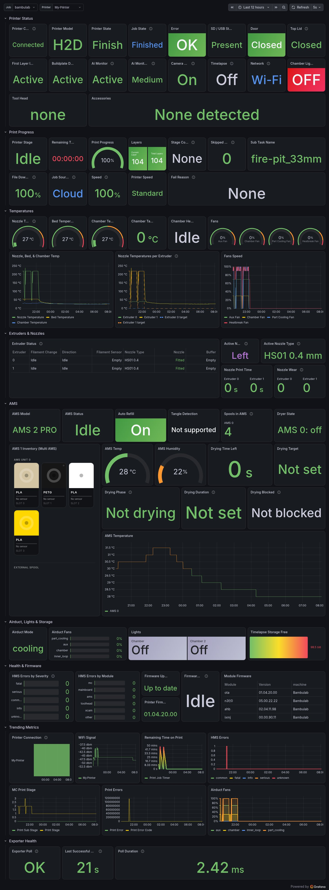

# Grafana Dashboard

A ready-made dashboard is published on
[Grafana.com (ID 25033)](https://grafana.com/grafana/dashboards/25033-bambulab-metrics/) and
included in the repository as `examples/grafana/dashboard.sample.json`.



---

## Requirements

- Prometheus scraping the exporter ([Prometheus Setup](Prometheus-Setup)). The **Job** dropdown
  lists Prometheus jobs whose name contains `bambulab`, so keep that in the job name.
- Exporter 0.2.0 or newer (older versions leave the newer panels empty).
- For the **AMS filament inventory** panel only: the free **Business Text** plugin and HTML
  rendering enabled:
  1. Install the plugin: `grafana-cli plugins install marcusolsson-dynamictext-panel`, or in
     Docker `GF_INSTALL_PLUGINS=marcusolsson-dynamictext-panel`, or **Administration > Plugins**.
  2. Allow HTML in panels: `GF_PANELS_DISABLE_SANITIZE_HTML=true`, or in `grafana.ini`:
     ```ini
     [panels]
     disable_sanitize_html = true
     ```
  3. Restart Grafana. Without step 2 the AMS panel shows plain text instead of spool cards.

All other panels use built-in Grafana panel types.

---

## Import

1. In Grafana open **Dashboards > New > Import**.
2. Enter **25033** and click **Load** (or upload `examples/grafana/dashboard.sample.json`).
3. Select your **Prometheus** data source and click **Import**.
4. Pick the **Job** and **Printer** at the top of the dashboard.

---

## Rows

- **Printer Status**: live printer connection, model, gcode state, job state (recent firmware),
  error flag, SD / USB storage, door, chamber light, XCam AI features, camera recording,
  timelapse, top lid (H2 family), wired or Wi-Fi network, mounted tool head and installed
  accessories. Other panels keep the last values received while the connection reads
  Disconnected
- **Print Progress**: stage, time remaining, progress, layers, stage countdown (recent firmware),
  speed profile, job name, then file download progress, job source (cloud or local), speed
  percentage, skipped objects and the fail reason when a print fails
- **Temperatures**: nozzle, bed and chamber gauges, chamber target and heater state, fan gauges
  (aux, chamber, part cooling, heatbreak), and trends for nozzle, bed and chamber, for each
  extruder's current and target temperature (extruder 0 is the right nozzle), and for fan speeds
- **Extruders & Nozzles**: an Extruder Status table with one row per extruder (filament change
  step in plain words, feed direction, filament sensor, loaded AMS slot, nozzle type and
  diameter, nozzle fitted, filament in the buffer), the active nozzle (right or left) on dual-nozzle printers, its type and
  diameter, nozzle print time and wear. Older
  printers show only the columns they report
- **AMS**: AMS model and status, auto refill, tangle detection setting, spools per unit, dryer
  state, filament inventory (Business Text spool cards), AMS temperature and humidity, drying
  time left and target, drying phase (heating or dehumidifying), set drying duration, why drying
  cannot start, AMS temperature trend
- **Airduct, Lights & Storage**: airduct mode and fan speeds, light states, timelapse storage
- **Health & Firmware**: active HMS errors by severity and module, firmware update available,
  firmware upgrade progress, printer and module firmware versions
- **Trending Metrics**: printer connection history, Wi-Fi signal, remaining time, HMS errors,
  machine stage, print errors, airduct fans
- **Exporter Health**: last poll result, time since the last successful poll, poll duration

Panels for hardware a printer does not have show a placeholder such as "No heater" or "N/A"
instead of an error. All queries filter on both `$job` and `$printer`, so one job can scrape
several exporters without mixing printers. The **Printer** dropdown lists `printer_name` values,
so printers with the same name appear as one entry: give each printer a distinct name.

---

## Alerts

Alert and recording rules are in [Prometheus Setup](Prometheus-Setup) and
`examples/prometheus/`.
